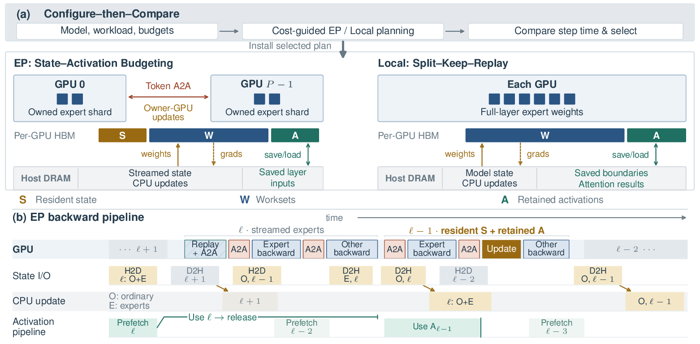
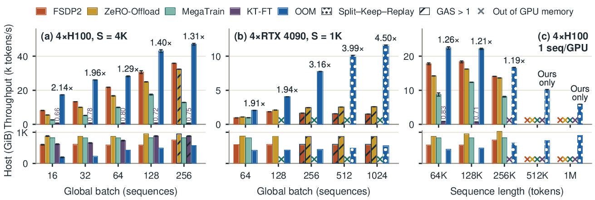

# OOM: Offload-Optimized Full-Parameter MoE Training

[](https://arxiv.org/abs/2611.11364)

> **Code release in preparation.** This repository will host the OOM training system. Watch this repository for release updates.

**Paper:** *OOM: Offload-Optimized Full-Parameter MoE Training via Memory-Execution Co-Design* ([arXiv:2611.11364](https://arxiv.org/abs/2611.11364))

Ruijia Yang, Shiyuan Lin, Chengxi Liao, Zeyi Wen
The Hong Kong University of Science and Technology (Guangzhou)

## Overview

OOM trains large mixture-of-experts (MoE) models with full-parameter updates on a single multi-GPU node. Model state lives in host memory and layer weights stream to the GPUs, so GPU memory becomes a performance budget shared by resident expert state, retained activations, and execution worksets. OOM co-designs expert execution with this memory allocation:

- **Expert-parallel execution with state–activation budgeting.** Each GPU owns and updates its resident experts. A dependency-based planner divides GPU memory among resident state, retained MoE activations, and routing worksets.
- **Local execution with Split–Keep–Replay.** Operators are partitioned along the axes their dependencies permit. In hybrid models, expensive attention results are retained on the host, while selected layer boundaries are regenerated through cheaper layers.
- **Configure-then-Compare.** Cost-guided planning configures each path for the workload and its GPU and host budgets. Short tests on a few repeating decoder units estimate full-model step times and select the faster configured path.



## Results

- **Long context:** OOM trains Qwen3.6-35B-A3B with 1M-token contexts on four H100s, whereas FSDP2, ZeRO-Offload, and MegaTrain exhaust GPU memory at 512K. A single H100 completes a 2M-token training step with YaRN ×8.
- **Large models:** OOM trains Qwen3.5-122B-A10B on four H100s, whereas all three baselines exhaust the node's host memory.
- **24 GB GPUs:** On four RTX 4090s, OOM trains 512K-token contexts, and 1,024 1K-token sequences per step without gradient accumulation.
- **Throughput:** OOM delivers 1.58× and 4.08× geometric-mean throughput over CPU-offloaded FSDP2 on H100 at 4K context and RTX 4090 at 1K context (2.92× over ZeRO-Offload on RTX 4090). It uses the least host memory among the evaluated systems, as little as 1/3.0 of FSDP2's.
- **Coverage:** five MoE models with 8–256 experts and up to 122B parameters, on four H100s, four RTX 4090s, and eight H100s.



*Batch-size and context-length scaling on four H100s and four RTX 4090s. Labels show speedup over the fastest baseline; KT-FT labels show k tokens/s.*

## Citation

```bibtex
@article{yang2026oom,
  title         = {{OOM}: Offload-Optimized Full-Parameter {MoE} Training via Memory-Execution Co-Design},
  author        = {Yang, Ruijia and Lin, Shiyuan and Liao, Chengxi and Wen, Zeyi},
  journal       = {arXiv preprint arXiv:2611.11364},
  eprint        = {2611.11364},
  archivePrefix = {arXiv},
  primaryClass  = {cs.DC},
  year          = {2026},
  url           = {https://arxiv.org/abs/2611.11364}
}
```

## Contact

Please open an issue, or contact Ruijia Yang (ryang379@connect.hkust-gz.edu.cn).

## License

The materials currently in this repository are released under the [Apache License 2.0](LICENSE). See [NOTICE](NOTICE) for attribution. The training code is still in preparation.
